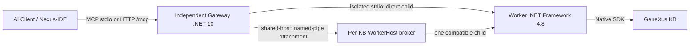

# GeneXus MCP Server — Multi-version GeneXus for Claude, Cursor, and AI Agents

[](https://www.npmjs.com/package/genexus-mcp)
[](https://www.npmjs.com/package/genexus-mcp)
[](https://opensource.org/licenses/MIT)
[](https://safeskill.dev/scan/lennix1337-genexus18mcp)
[](https://github.com/hashgraph-online/awesome-ai-plugins)

> **¿Hablás español?** → [Guía de inicio en español](docs/GETTING_STARTED.es.md)
> **Fala português?** → [Guia de início em português](docs/GETTING_STARTED.pt-br.md)
> **Stuck?** → [Troubleshooting guide](TROUBLESHOOTING.md)
> **All docs** → [Documentation index](docs/README.md)

---

**GeneXus MCP Server** lets AI agents — Claude Desktop, Claude Code, Cursor, Antigravity, and any MCP-compatible client — read, edit, analyze, and refactor objects inside a Knowledge Base supported by the selected native SDK or legacy compatibility driver. Native SDK paths work with the **real GeneXus SDK** and legacy paths use explicit reflection/COM adapters; neither path relies on a parsed copy of the KB.

In practice: you point the MCP at your KB, then ask your AI assistant things like *"list all transactions with attribute CustomerId"*, *"add a rule to the Order transaction that validates the total"*, or *"refactor this procedure to use the new SDT"* — and it does it.

---

## Multi-version GeneXus support

The same MCP distribution supports the official native SDK majors listed in the
generated compatibility document. It also includes basic, best-effort
compatibility for the legacy versions listed there through separate drivers;
that path is not equivalent to full native-SDK support. A process can route
each declared KB to its own SDK/driver; `--gx` remains the convenient global
default for a single-major configuration. The commands below are examples of
switching the existing configuration:

```bash
npx genexus-mcp@latest init --kb "C:\KBs\KBTeste17" --gx "C:\Program Files (x86)\GeneXus\GeneXus17Trial"
# To switch this MCP configuration to GX18:
npx genexus-mcp@latest init --kb "C:\KBs\MyGX18KB" --gx "C:\Program Files (x86)\GeneXus\GeneXus18"
```

After switching the SDK or KB, fully restart the AI client so it reloads the
MCP process and its tool schemas. If GX17 and GX18 must run simultaneously,
use separate MCP configurations and ports.

Classic GX8/GX9 KBs can be opened without changing the global GX18 default by
declaring their driver and installation per KB (the Gateway accepts both the
list and object catalog shapes):

```json
{
  "Environment": {
    "KBs": {
      "SECT80": {
        "Path": "D:\\GX80\\SECT",
        "Driver": "com-gxpublic",
        "InstallationPath": "C:\\Program Files (x86)\\ARTech\\GeneXus\\gxw80",
        "Major": "8"
      }
    }
  }
}
```

The equivalent one-shot request is `genexus_kb action=open` with `path`,
`alias`, `driver: "com-gxpublic"`, `installationPath`, and `major: "8"`.
GX8 uses the registered 32-bit GXPublic provider; the documented `.4` ProgID
and the installed `GXPubGXX.GXPublic(.5)` compatibility registration are
recognized. Classic DAT KB roots are identified from their legacy markers
(`DATA001`, `GXSPC001`, `kbdata`, `ATTRIBUT.DAT`, or `ATT.XPW`).

`init` also reads the KB `.gxw` major and the selected `GeneXus.exe` metadata.
It aborts before writing `config.json` when the majors conflict or an automatic
selection cannot be verified. When several installs share the KB major, the
automatic selection prefers the one whose update matches the `.gxw` version
(e.g. U7 for an `18.0.7.x` KB) over the newest one. `genexus-mcp doctor` exposes the same result as
the `kb_sdk_compatibility` check. For a disposable fixture, the
[live-KB harness](docs/live-kb-test-harness.md) includes a catalog-driven matrix
that checks every supported major against one published artifact.

The Gateway reports the detected SDK through `genexus_whoami`:

- `geneXus.supportedMajors`: explicitly validated native SDK majors from the version catalog
- `geneXus.legacyMajors`: catalogued legacy majors handled by their compatibility drivers
- `geneXus.sdkCompatibility.supportLevel`: `native-sdk` or `basic-legacy` for the detected installation
- `geneXus.matchedMajor`: the major detected for the configured installation
- `geneXus.versionMatches`: whether the detected installation is in that catalog
- `geneXus.supportedMajor`: retained as the legacy single-major alias for the catalog primary

The Worker isolates version-sensitive SDK members behind compatibility adapters.
For example, Design System helper methods that differ between SDK majors are
replaced field-by-field by parsing the native `Tokens` and `Styles` parts when
needed. Existing tool names, arguments, and MCP client configuration formats do
not change.

<!-- BEGIN GENERATED: gx-compatibility -->
Supported SDK majors: **GeneXus 16, GeneXus 17, GeneXus 18** (native SDK).
Basic legacy compatibility: **GeneXus Evolution 3, GeneXus Evolution 2, GeneXus Evolution 1, GeneXus 15, GeneXus 9.0, GeneXus 8.0** via `com-gxpublic` and `dotnet-reflection` (not the native SDK build).
Primary SDK: **GeneXus 18**.
Source of truth: `config/gx-versions.json`.
<!-- END GENERATED: gx-compatibility -->

To add another native-SDK major in the future, add it to the explicit
`supportedMajors` catalog only after compiling the Worker with that SDK and
passing the focused tests plus a live KB smoke. This prevents the server from
claiming native-SDK compatibility based only on a version string.

### Basic legacy compatibility (not native SDK support)

Every legacy version currently declared in `legacyMajors` uses a best-effort
driver rather than the native SDK build:
- **GeneXus Evolution 1 (10.1), Evolution 2 (10.2), Evolution 3 (10.3), and GeneXus 15**: Driven via runtime reflection (`dotnet-reflection`), dynamically adapting to missing types or structural differences (such as module-less KBs without `QualifiedName`).
- **GeneXus 8.0 and GeneXus 9.0**: Driven through the classic GXPublic surface (`com-gxpublic`), detected from `gxw32.exe`/`gx.exe`/`gxdl32.dll` and classic `.gxi` Knowledge Bases. GXPublic is a metadata-oriented OLE DB surface; this path is intentionally limited to basic metadata/core operations and does not claim native-SDK source/edit parity.
- **Graceful degradation**: Modern tools that require features introduced in newer GeneXus versions (such as `genexus_api`, `genexus_gam`, or `genexus_module`) return structured `UNSUPPORTED_IN_GENEXUS_VERSION` errors indicating the required minimum version rather than failing ungracefully.

This legacy path is intended for basic core operations where implemented; it
does not claim the same feature parity as the native SDK contract for GeneXus
16, 17, and 18.

---

## Experimental `gx-engine` (Rust SDK Replacement Project)

`src/gx-engine` is an independent, high-performance Rust compiler and runtime designed to completely replace the proprietary GeneXus SDK, eliminate the legacy 32-bit STA worker, and deliver sub-20s builds ([Plan 130](plans/130-direct-udm-kb-engine.md), [Plan 129](plans/129-independent-rust-toolchain.md)).

### 🎮 Decompilation / Parity Progress

Progress is measured against recorded SDK differential inputs and observable results, not the number of implemented modules or passing unit tests. At the published 4.0.0 baseline, the disposable `KBTeste` Rebuild All recorded **346/346, 0 skipped, 0 refused** and **byte for byte (328/328 files)** C# agreement, together with web scripts, `gxcfg.js`, messages and runtime configuration. These historical counts do not validate later changes or prove that unsupported database semantics were preserved. **Full SDK replacement is not verified** for arbitrary KBs: unsupported forms are still refused by name, and only one KB is the oracle. gx-engine is the **default backend** (`Engine.Backend=gxengine`: admitted builds and field-limited type-only queries; reads/edits and other shapes use SDK fallback; `auto` = builds only, `sdk` = engine off); see [engine routing](docs/engine_backend.md).

### What builds today

The counts and timings below describe the published 4.0.0 baseline, not a fresh
validation of uncommitted generator changes. Checked emission now refuses
unsupported database statements rather than accepting incomplete behavior;
post-change whole-KB counts and SDK parity must be measured again.

| Lane | Verified evidence | Boundary |
| :--- | :--- | :--- |
| Package build | `build.ps1` built Gateway, Worker, gxwire and gx-engine; local publish/backend engine hashes match. | Building the MCP distribution is not building every object in a KB. |
| Selected-object build | Five alternating local SDK/engine pairs regenerated and compiled `DCM37961700`; core APIs and actual CLI output matched. SDK median **14.756s**, engine **0.230s** (**64.19×**). | Synthetic warm fixture; AUTO_CLOSE=OFF on both sides, original ON restored. The packaged binary was not benchmarked; it passed a separate build/run smoke. |
| Full native KB build (`KBTeste`) | `rebuild-all`: **346 generated / 346 compiled, 0 skipped, 0 refused**. Against the SDK's own output for the same KB: **328/328 C# files byte-identical, 0 missing**; 24/24 web `.js`, `gxcfg.js`, `messages.eng.txt/.js`, `log.config`, `log.console.config` (+ `bin/` copies) and `CloudServices.config` byte-identical. | One oracle KB. Extra SDT and assembly-info output remains outside the matching-file denominator. Developer Menu not written (its object selection is not established). |

Use the SDK for required workflows outside validated engine coverage. See
[Plan 131](plans/131-sdk-performance-benchmark.md) for the exact binary, commands,
samples and caveats; [engine routing](docs/engine_backend.md) for default/explicit backend behavior.

| Subsystem | Evidence boundary / remaining work |
| :--- | :--- |
| Language, runtime, control flow, SDTs and collections | Bounded native differential corpora; not exhaustive GeneXus semantics. |
| Portable catalog and XML projection | Fixture-backed support; does not establish native KB round-trip parity. |
| Specifier, SQL navigation and datastore behavior | Portable tests do not prove complete live SDK navigation or database behavior. |
| Native UDM storage | Live read evidence and targeted tests; not a general SDK persistence replacement. |
| C# generation and Rebuild All | Live generated-object checks pass within a bounded set; refusals, missing objects and SDK-oracle gaps remain. |
| Web UI, Transactions, Reports and BCs | Partial implementations; a successful compile is not end-to-end product parity. |

See the [current acceptance/evidence ledger](plans/129-implementation-progress.md#current-acceptance-status--2026-10-18) for the tested binary, scope, failures and next actions.

#### Gateway Capability Registry Gates

The MCP Gateway exposes an evidence gate (`EngineCapabilityRegistry`). See the
[current capability table](docs/engine_backend.md) for each bounded status,
consumer and evidence source. Runtime oracle fixtures, portable model tests and
live MCP compatibility are different kinds of evidence; none is an overall SDK
replacement percentage.

- Native-runtime oracle rows cover only their recorded inputs, encodings and
  environment; synthetic library tests alone do not establish native parity.
- Admitted type-only queries and blocking builds/rebuilds are the current native
  MCP surface. Reads and edits remain SDK-backed or fail closed; routing a call
  to a deferral guard is not native implementation coverage.
- Storage decoding, navigation planning, object modeling and C# emission remain
  partial. Unsupported database statements must fail generation rather than
  produce a successful Procedure with missing database behavior.

The published 4.0.0 `KBTeste` result (346 compiled classes, 328 matching SDK C#
files and 20 extra files) is historical, bounded evidence. It is not a fresh
validation of later safety changes, all object families or whole-SDK behavior.
The [full-parity acceptance plan](plans/132-gxengine-full-parity.md) tracks the
remaining workflows and evidence required.

### ⚡ Performance Benchmarks (gx-engine vs. GeneXus SDK)

A speed comparison requires the same input workload, target, dependency closure, observable results and success criteria. Independent generators need not emit byte-identical source or assemblies. Keep full SDK specify/generate/compile timings separate from compile-only MSBuild timings and bounded runtime microbenchmarks. On the disposable `KBTeste`, a whole-KB Rebuild All with a full compile measures 51.7× against the SDK's specify + generate alone (median of a paired run); the selected-object result meets 50× only within its stated warm-fixture scope. Historical microbenchmarks do not establish a whole-KB speed goal.

**Scope of these numbers.** They were measured on disposable KBs with a single Design model. The engine builds only a KB with a single Design model, and a KB that has ever had a version has at least two, so there every build runs on the SDK ([why](docs/engine_backend.md#why-a-build-in-a-kb-with-versions-still-runs-on-the-sdk-issue-637)). It also needs SQL credentials in the process environment or the connection file for a KB on SQL Server with SQL authentication, and it skips web UI objects (a partial build, exit 3). A type-only `genexus_query` is served by the engine only when `fields` is limited to `name`/`type`, and once the SDK search index is warm it is faster on the SDK: 38 ms of SDK time against 300–370 ms for the engine on an 86-Procedure KB behind a remote SQL Server (2026-10-23, direct `kb-query` against the Gateway's `sdkMs`). The engine query path therefore helps mainly before the SDK index is ready.

| Benchmark Workload | GeneXus SDK (.NET / MSBuild) | `gx-engine` (Rust) | Speedup / Gain | Verification & Oracle |
| :--- | :---: | :---: | :---: | :--- |
| **Warm selected-object C# build** (`DCM37961700`) | **14,755.9 ms** *(local specify + generate + Rebuild/Publish)* | **229.9 ms** *(live read + emit + guarded compiler replay, setup included)* | **64.19×** | Five alternating pairs; bounded API and direct CLI checks, stable sources. Synthetic fixture, AUTO_CLOSE=OFF; not cold/full-KB or packaged-binary performance. [Protocol](plans/131-sdk-performance-benchmark.md). |
| **`Str()` Numeric Picture Formatting** (Microbenchmark) | 274 – 286 ns / row *(1.75 ms / pass)* | **121 – 130 ns / row** *(0.75 ms / pass)* | **~2.25x faster** | 6,152 rows (`str_matrix.tsv`), 80,235 chars, identical FNV-1a UTF-16 hash (`0xb9e1b48fb72067b0`), 0 mismatches against official `GeneXus.Classes.Core` runtime. |
| **Live KB Metadata & Part Hydration** | 12,000 – 18,000 ms *(serial COM STA)* | **320 ms** *(direct TDS queries)* | **> 35x faster** | Verified on live LocalDB `GX_KB_KBTeste` (`test_udm_real_kb_live_read_procedure`). |
| **Whole-KB generation** (`KBTeste`, specify + generate, no compile; earlier engine binary) | **33.4 – 39.9 s** *(MSBuild `SpecifyAllOnly` + `GenerateOnly`, 3 runs)* | **0.61 – 0.68 s** *(`rebuild-all --skip-compile`, 3 runs alternating with the SDK runs; ~0.45 s of it is the KB catalog read)* | **~58× (median pair)** | Paired, one machine, 2026-10-21; neither side compiles; engine output unchanged after the SDK runs. Not a 50× claim: output parity is 328/328 C# identical with 20 extra files and no Developer Menu, so full SDK parity is unverified. The previous engine binary measured 1.29 – 1.40 s (12 alternating runs). |
| **Whole-KB Rebuild All, nothing changed** (`KBTeste`, 346 classes) | **42.2 s** median *(32.3 – 46.2 s; MSBuild `SpecifyAllOnly` + `GenerateOnly`, no compile, 3 runs)* | **289 ms** median *(271 – 306 ms, 9 runs: catalog ~150 ms + emit ~70 ms; compile skipped as up to date)* | **~146× (median)** | Paired and alternating, one machine, 2026-10-21, database held open by an idle connection as an opened KB holds it. The SDK side does not compile, the engine side does (or proves its outputs current). Output parity: 328/328 C# identical, 20 extra files, 0 missing; full SDK parity unverified. Script `bench-s42.py`. |
| **Whole-KB Rebuild All, forced full compile** (`KBTeste`, 346 classes) | **42.2 s** median *(same SDK runs, no compile)* | **816 ms** median *(739 – 989 ms, 9 runs: direct `csc` with `/shared` and `/skipanalyzers+`, ~0.6 – 0.7 s)* | **~51.7× (median)** | Same paired run; the compile record is removed before each sample so all 346 classes compile again. The ratio is a median of medians: against the fastest SDK run (32.3 s) and slowest engine run it is ~33×. A first build into a new folder takes ~1.9 s (`dotnet build`); a cold compiler server was measured once at ~22.8 s. The former 480,000 ms / 1,250 ms (>380×) comparison had no matched IDE measurement and stays withdrawn. |
| **Historical arithmetic fixture build** | 10,930 ms *(SDK stages)*<br>16,366 ms *(MSBuild process wall)* | **223 ms** *(Rust CLI + rustc build)* | **Not a whole-SDK speed ratio** | `RustTimingProbe` (`21 * 2 = 42`), three recorded samples, exit/output checked. Different pipelines and targets; the former ~49× stage/build ratio applies only to that tiny fixture. [Evidence and caveats](src/gx-engine/VALIDATION.md#verified-custom-msbuild--sdk-pipeline). |
| **Generated Artifact Startup & Execution** | 123.06 ms *(CLR bootstrap + run)* | **5.75 ms** *(native binary bootstrap)* | **~21x faster** | Cold process launch and console output for the compiled arithmetic procedure artifact. |

#### 📈 Benchmark Protocol & How to Record Improvements

As new capabilities reach parity and additional optimizations land, follow this protocol to update this ledger:

1. **Verify Parity First:** No benchmark is valid without zero diffs against the official SDK or recorded native differential fixture:
   ```powershell
   python src/gx-engine/scripts/benchmark.py --iterations 100
   ```
2. **Standardized Environment:** Keep compiler flags, hardware specifications, and iterations explicit (see [src/gx-engine/VALIDATION.md](src/gx-engine/VALIDATION.md)).
3. **Record in Ledger:** Update this table and [plans/129-implementation-progress.md](plans/129-implementation-progress.md) with: workload description, GeneXus SDK baseline, gx-engine timing, observed speedup ratio, and the committed evidence fixture.

### Activation Flag & Safety Seam

> [!IMPORTANT]
> **Engine-first:** `Engine.Backend` defaults to `"gxengine"`. Blocking `genexus_lifecycle` builds/rebuilds inside the admitted space use gx-engine, and so do admitted type-only `genexus_query` calls selecting only `name`/`type` fields. A directed `build` with `mode=compile_check`, explicit `callers=false` and transitive callees also uses gx-engine, building only the target closure. Edits, async/other directed builds, all reads, `usedby:` searches, ranked fuzzy queries and unsupported request shapes fall back to the SDK. Capability and argument gates still apply. Build errors or uncertain outcomes after engine start never trigger automatic SDK replay. `"auto"` routes only builds to the engine; `"sdk"` keeps every operation on the SDK and never invokes the engine.

No backend setting is needed. To narrow routing to builds (`"auto"`) or turn the engine off (`"sdk"`), configure `config.json`:

```json
{
  "Engine": {
    "Backend": "auto",
    "Fallback": "sdk",
    "TimeoutSeconds": 120
  }
}
```

- **`Engine.Backend`**: `"gxengine"` (default: admitted builds and field-limited type-only queries; reads/edits use SDK fallback), `"auto"` (admitted builds only), or `"sdk"` (SDK only, engine never invoked).
- **`Engine.Fallback`**: `"sdk"` (fallback to GeneXus SDK outside admitted native coverage) or `"error"` (fails closed: `EngineCapabilityNotParity` for evidence-gate rejection; `EngineOperationOutsideAdmittedSpace` for read/edit deferrals and unsupported query/build arguments).
- **Diagnostics**: `genexus_doctor` inspects the engine via `--version` handshake and reports an `engine` status block with `backend`, `available`, `version`, and `capabilities`. Its `routedOperations` lists served native operations; `deferredOperations` lists read/edit deferrals separately, never as parity.

To run compiler tests or standalone projects from checkout:

```powershell
cargo test --manifest-path src/gx-engine/Cargo.toml
cargo run --manifest-path src/gx-engine/Cargo.toml -- check src/gx-engine/fixtures/demo.json
```

See [docs/engine_backend.md](docs/engine_backend.md), the [engine guide](src/gx-engine/README.md), and the [capability matrix](plans/129-sdk-capability-matrix.md) for full architecture and evidence ledgers.

---

## Sharing one Worker between MCP clients

The Gateway and the GeneXus SDK Worker have different responsibilities. By
default, `Server.WorkerSharingMode` is `"isolated"`: each Gateway owns its own
Worker process. Keep that mode when an agent intentionally needs multiple
independent Workers.

When two or more independent MCP clients need to work on the same physical KB,
set `WorkerSharingMode` to `"shared-host"` in a `stdio-isolated` configuration:

```json
{
  "ConfigSchemaVersion": 2,
  "GatewayMode": "stdio-isolated",
  "GeneXus": {
    "InstallationPath": "C:\\Program Files (x86)\\GeneXus\\GeneXus18",
    "WorkerExecutable": "C:\\path\\to\\GxMcp.Worker.exe"
  },
  "Server": {
    "HttpPort": 0,
    "McpStdio": true,
    "WorkerSharingMode": "shared-host"
  },
  "Environment": {
    "ResolutionPolicy": "strict",
    "KBs": [
      { "alias": "main", "path": "C:\\KBs\\YourKB" }
    ]
  }
}
```

`shared-host` shares only the per-KB broker-owned SDK Worker through bounded
local named-pipe attachments. The Gateways remain independent: MCP sessions,
authorization, KB selection, caches, request tracking, cancellation, progress,
notifications, and generated artifacts do not cross the process boundary.
Sharing is accepted only when the physical KB, Worker executable, GeneXus
installation, driver, and target major are compatible; a mismatch fails closed
instead of attaching to the wrong SDK process.

Writes carry a Gateway-local owner into the Worker. The same object/part cannot
be written concurrently by two attached clients, while writes to distinct
objects may proceed independently through the shared SDK boundary. The Worker
itself remains a single STA process, so calls that reach the same SDK are still
serialized as required by GeneXus.

For a healthy shared attachment, `genexus_whoami` and `genexus_doctor` report the
mode, identity key, pipe, host/Worker PIDs, generation, attachment ID, connection
state, and the latest startup/failure diagnostic. When something fails, inspect
`worker.diagnostics` and `workerHealth` before restarting or deleting local
state; these fields distinguish configuration/identity, mutex or registry,
pipe/handshake, startup, child exit/respawn, TTL, and frame failures.

See [Worker ownership](docs/worker-ownership.md) for the lifecycle contract and
[the shared-Worker benchmark](docs/benchmarks/2026-09-18-shared-worker.md) for
the measured two-client smoke and backpressure results.

---

## What you can do with it

A quick map of what the agent can do against your real KB through the **60 tools** (details in [Tool Surface](#tool-surface)):

| Area | What the agent can do |
|---|---|
| 🔎 **Explore** | Search & list objects, read any part (source, rules, events, structure, docs, pattern XML), inspect metadata & callers, regex-search source, view the navigation report |
| 🧭 **Orient & trace** | Rank the objects a task touches, list direct and transitive callers, trace the shortest call path between two objects, check blast radius and safe-delete, follow one variable's data flow. Runs on exported sources through `genexus_wire` (read-only, token-budgeted); `pack_task` also works directly on the open native KB |
| ✏️ **Edit code** | Edit any object part (`full`/`patch`/`ops` modes), variables CRUD, format, create & delete objects, scaffold a Procedure from a **curl command**, edit + rebuild callers in one shot |
| 🗄️ **Author the data model** | Transaction structure (DSL), **unique/non-unique indexes** (create & drop), **attribute formulas & subtypes**, level Description/Image attributes, **Domain enum values**, folders & modules, table↔transaction relations & redundant-attribute detection |
| 🧩 **Author other objects** | External Object methods & properties, Menu options, REST API objects, WorkWithPlus / WorkWith patterns, typed .NET generator references |
| 🎨 **UI & WorkWithPlus** | Full read/write of pattern XML (controls, actions, grids, orders, groups), theme classes & styling, native WebForm/layout edits, **control catalog & design-system tokens/classes/images**, headless-browser verification |
| 🔬 **Analyze** | Impact/dependency analysis, complexity & code metrics, naming, explain-what-this-does, KB activity/freshness, reorg/DDL impact preview, native security scan, schema-drift check |
| 🛠️ **Build, test & deploy** | Build (full or fast `compile_check`), validate, reorg, index, run native GXtest tests, deploy the application (targets + deploy) |
| 🔀 **Refactor & compare** | Rename across the KB, extract procedure, compare & merge objects (IDE parity) |
| 🌿 **Versioning, transfer & teams** | KB model versions/branches, **real XPZ export/import** (dependency-aware), GXserver (Team Development) sync + **CI pipelines**, git-style history, multi-KB parallel work |
| 🔐 **Security** | GAM / integrated-security provisioning, KB security audit + native Security Scanner |

Native SDK support works through the **native GeneXus SDK** — the same code paths
the IDE uses — so edits are real and validated, not text hacks on KB files.
Legacy support uses the reflection or COM driver listed in the catalog and
degrades unsupported modern tools explicitly.

---

## Prerequisites

Before you start, make sure you have:

- ✅ **Windows** (GeneXus is Windows-only)
- ✅ **A supported GeneXus installation** installed locally: GeneXus 16, 17, or 18 for native SDK support, or a catalogued legacy installation for basic compatibility (see [`docs/generated/supported-versions.md`](docs/generated/supported-versions.md); pass another install path explicitly when needed)
- ✅ **GeneXus 18** installed locally for the primary native-SDK path; other catalogued native and legacy versions are also supported according to their listed driver
- ✅ **A Knowledge Base created with a supported native or legacy GeneXus major** and opened at least once in the IDE (so it's initialized)
- ✅ **Node.js 22+** — check with `node --version` in a terminal; install from [nodejs.org](https://nodejs.org/) if missing
- ✅ **An MCP-compatible AI client** — [Claude Desktop](https://claude.ai/download), [Claude Code](https://claude.com/claude-code), Cursor, Antigravity, etc.

You do **not** need to clone this repo or install anything globally — `npx` handles it.

**Never used a terminal before?** Press `Win+R`, type `powershell`, hit Enter. That's your terminal.

---

## Quickstart (3 steps, ~5 minutes)

### Find your two paths first

Before running the installer, note these down:

1. **GeneXus install folder** — where `GeneXus.exe` lives. Usually `C:\Program Files (x86)\GeneXus\GeneXus18`.
2. **Your KB folder** — the root folder of your Knowledge Base (contains the `.gx` file and subfolders like `Model/`, `WebSpa/`).

Not sure where your KB lives? Open it in GeneXus and check the title bar, or look in `File → Recent`.

### Step 1 — Run the installer

Open a terminal and run, replacing the paths with **your** KB folder and **your** GeneXus install:

```bash
npx genexus-mcp@latest init --kb "C:\KBs\YourKB" --gx "C:\Program Files (x86)\GeneXus\GeneXus18"
```

> Prefer the wizard? Run `npx genexus-mcp@latest init --interactive` and answer the prompts.

What you'll see (takes ~30 seconds first time, faster on re-runs):

1. `npx` downloads the package.
2. The installer verifies the paths exist and GeneXus is present.
3. It **auto-detects** which AI clients you have installed and adds the MCP config to each one.
4. Prints a JSON snippet at the end — keep it in case you need to configure a client manually.
5. Finishes with `🎉 You are all set!`.

On Windows, Antigravity is registered with the gateway executable bundled in the
current npm package when that artifact is available, so it skips the npx bootstrap
chain on every MCP handshake. That path follows the package in the npx cache; after
an upgrade, run `npx genexus-mcp@latest clients add --clients antigravity` again if
`genexus-mcp clients` reports a stale launcher. Other clients keep the `npx genexus-mcp@latest`
launcher unless you use the fixed-path installer below.

### Step 2 — Register the MCP in your AI client

Step 1 auto-registers every supported client it detects, including Claude Desktop, Claude Code, Cursor, Antigravity, Gemini CLI, OpenCode, Codex CLI, and VS Code. If yours wasn't detected, copy the JSON snippet from Step 1 into your client's MCP config manually. See the [client setup guide](TROUBLESHOOTING.md#client-setup) if unsure where that file lives.

### Step 3 — Restart your AI client, then test

This part trips most people: **fully close** your AI client and reopen it. Not just the window — the whole process.

- **Claude Desktop**: right-click the system-tray icon → **Quit**. Then launch it again. (Closing the window is not enough.)
- **Claude Code**: end the session and start a fresh one.
- **Cursor / Antigravity**: close all windows and reopen.
- **OpenCode**: fully quit and reopen it so it reloads `opencode.json` / `opencode.jsonc`.
- **Gemini CLI / Codex CLI**: start a new process or session.

Then paste this prompt:

> *"Using the GeneXus MCP, list the first 5 objects in my KB and show name + type."*

**What should happen:**

- The AI invokes the `genexus_list_objects` tool (some UIs show "calling tool…").
- A few seconds later, you get a list of objects from your KB.

If you get a list back — **you're done**. Skip to [What can I ask the AI?](#what-can-i-ask-the-ai) for ideas.

If the AI says it doesn't have a GeneXus tool, or nothing happens, go to [Troubleshooting](TROUBLESHOOTING.md) — most issues are covered there.

---

## 🤖 Let your AI install it for you

If you'd rather not run anything in the terminal yourself, paste this into your AI chat:

> Please configure the GeneXus MCP server. Run `npx genexus-mcp@latest init --kb "<MY_KB_PATH>" --gx "<MY_GENEXUS_PATH>"` in the terminal. If I haven't told you my GeneXus path and KB path yet, ask me first. Once it succeeds, read the JSON block it printed and add it to my MCP client config. Tell me when I should restart the client to start using GeneXus tools.

Replace the placeholders or let the AI ask you for them.

---

## Corporate install (fixed path, ASR-friendly)

If your machine has **Microsoft Defender ASR**, **SmartScreen**, or another endpoint policy blocking unsigned binaries, the default `npx` flow is painful — `npx` caches the package under `%LOCALAPPDATA%\npm-cache\_npx\<hash>\...`, and the `<hash>` changes per version, so IT can't whitelist a stable path without a wildcard over the whole npm cache (which is too broad).

Use the corporate installer instead. It extracts the binaries to a stable directory and registers the AI clients to launch the gateway directly from there — `npx` is never on the runtime path.

```pwsh
# One-liner — installs latest release, registers AI clients
iex (irm https://raw.githubusercontent.com/lennix1337/Genexus18MCP/main/scripts/install.ps1)

# With explicit KB and GeneXus paths
$s = irm https://raw.githubusercontent.com/lennix1337/Genexus18MCP/main/scripts/install.ps1
& ([scriptblock]::Create($s)) -Kb "C:\KBs\MyKB" -Gx "C:\Program Files (x86)\GeneXus\GeneXus18"
```

Install location:

- **Admin shell** → `C:\Tools\GenexusMCP\`
- **Non-admin shell** → `%LOCALAPPDATA%\Programs\GenexusMCP\`

Paths to give to IT for the ASR / Defender exclusion list:

```
<InstallDir>\GxMcp.Gateway.exe
<InstallDir>\worker\GxMcp.Worker.exe
```

Re-run the same one-liner later to **upgrade** — it detects the installed version (`version.txt` in the install dir) and downloads only if a newer release is available. Use `-Force` to reinstall the same version, `-Version v2.3.0` to pin a specific tag, `-NoClient` to skip AI client registration. Node.js 22+ must be installed for client registration; without it the script still extracts the binaries but you'll need to edit the client config (`claude_desktop_config.json` etc.) manually.

---

## What can I ask the AI?

Once installed, here's what unlocks. Try these as your first prompts:

**Exploration**
- *"List all objects of type Procedure in the KB."*
- *"Show me the source of the procedure CalculateInvoiceTotal."*
- *"Find all transactions that reference the attribute CustomerId."*

**Editing**
- *"Add a rule to the Order transaction: error('Total must be positive') if Total < 0."*
- *"Add a new attribute CreatedAt of type DateTime to the Customer transaction."*
- *"Rename the variable &qty to &quantity in procedure CreateOrder."*

**Data model authoring** (no IDE round-trip)
- *"Make CustomerEmail unique on the Customer transaction."* (creates a unique index)
- *"Turn CustomerBalance into a formula: sum(InvoiceAmount)."*
- *"Add the enum values Active/Inactive/Pending to the Status domain."*
- *"Add a property apiKey and a method Connect(url) to the PaymentGateway external object."*
- *"Add a menu option 'Customers' to MainMenu that opens CustomerWW."*

**WorkWithPlus pattern editing** (full structural + theming control)
- *"Add a typed tab with variables, an action, and nested responsive tables to a WorkWithPlus WebPanel."*
- *"In WorkWithPlusOrder, add a 'Duplicate' button to the transaction view alongside Save/Cancel/Delete."*
- *"Group the Customer transaction attributes into a 'Contact Info' section with theme class GroupTelaResp."*
- *"On the WorkWithPlusInvoice list, add a new ordering by InvoiceDate descending."*
- *"Style the Save button on WorkWithPlusOrder with buttonClass='btn ButtonGreen' and apply BigTitle to the form header."*
- *"Remove the Export action from the Selection grid of WorkWithPlusReport."*
- *"Read the Documentation part of the transaction Customer and rewrite it in markdown."*

**Architecture, call graph & impact** (`genexus_wire`)
- *"Before I change CliSaldo, what is the blast radius? Which procedures write it?"*
- *"Who calls PValidaCreditoLive, directly and through other procedures?"*
- *"Show me the call path from PEmiteFaturaLive to PValidaCreditoLive."*
- *"I need to change the invoice interest calculation. Where should I start?"*

**Analysis**
- *"Explain what the procedure ProcessShipment does."* — `genexus_analyze mode=explain` is a compatibility-only envelope and returns `NotImplemented`; use `mode=summary`, `mode=context`, or `genexus_read` for supported analysis and source.
- *"What SQL does the query in WebPanel CustomerList generate?"*
- *"Summarize the structure of the Sales module."*

**Build & lifecycle**
- *"Build the KB and report any errors."*
- *"Run the unit tests and show me which failed."*

The agent picks the right tool from the **60 tools** the MCP exposes (read, edit, refactor, analyze, build, data-model authoring, layout automation, DB/DDL, versioning, security, SQL preview, etc.). The full tool list is in [Tool Surface](#tool-surface) below.

---

## Supported AI clients

Auto-detected and auto-configured by the installer:

| Client | Auto-config | Notes |
|---|---|---|
| Claude Desktop | ✅ | Restart required after install |
| Claude Code (CLI) | ✅ | Reload session |
| Cursor | ✅ | Restart required |
| Antigravity | ✅ | Direct packaged gateway; restart required; detected even before its MCP config exists |
| Gemini CLI | ✅ | — |
| OpenCode (CLI) | ✅ | Reads both direct and nested MCP layouts; restart required |
| Codex CLI | ✅ | Writes `~/.codex/config.toml` |
| VS Code / VS Code Insiders | ✅ | Native MCP (`User/mcp.json`); restart required |
| OpenCode Desktop | ✅ | Shares `opencode.jsonc` with OpenCode CLI; restart required |
| Any MCP client | Manual | Use the JSON snippet printed by `init` |

Run **`npx genexus-mcp clients`** at any time to see which agents are installed, which have `genexus` registered, and whether any point at a stale gateway exe. To (re)register specific ones: `npx genexus-mcp clients add --clients antigravity,vscode`.

### OpenCode Desktop

OpenCode Desktop shares its MCP configuration file (`opencode.jsonc` or `opencode.json`)
with OpenCode CLI. Running `genexus-mcp init --write-clients` or `genexus-mcp clients add --clients opencode-desktop`
automatically registers `genexus18mcp` in the shared config. After registration,
fully restart OpenCode Desktop so it reloads its MCP configuration.

---

## Troubleshooting

First stop for any "the agent doesn't see GeneXus" problem: **`npx genexus-mcp clients`** (is it registered? does it point at a gateway exe that still exists?) and **`npx genexus-mcp doctor --mcp-smoke`**.

Most install issues fall into a handful of buckets — see **[TROUBLESHOOTING.md](TROUBLESHOOTING.md)** for fixes:

- Installer can't find GeneXus or the KB
- AI client doesn't see the GeneXus tools after restart
- "Worker failed to start" / .NET 4.8 errors
- KB build errors / locked artifacts
- Port 5000 already in use
- Permissions on `%LOCALAPPDATA%\GenexusMCP\`
- Antigravity only shows `exit status 1` / `0xffffffff` with no useful stderr

When a stdio launcher fails before the client can retain stderr, the wrapper writes
the last failure to `%LOCALAPPDATA%\GenexusMCP\logs\last-stdio-error.txt`. It contains
the UTC timestamp, exit code, and bounded stderr tail. `genexus-mcp doctor` reports the
same path when a previous failure is present. Read it before changing the install or
using a global npm install; if the Antigravity launcher is stale, re-register it with
`npx genexus-mcp@latest clients add --clients antigravity`.

### Diagnosing a shared Worker failure

If `shared-host` does not attach or a Worker is restarted, run
`genexus_whoami` and `genexus_doctor` from the affected client and preserve the
structured `worker.diagnostics`/`workerHealth` block. The useful evidence is the
mode, identity, host/Worker PID, generation, attachment state, connection error,
and failure diagnostic — not only the final `no_worker` or `startup_failed`
summary. Do not remove a shared-worker registry file while a matching host is
still running; the broker owns that lifecycle and stale records are recovered
after PID/start-time validation.

Still stuck? [Open an issue](https://github.com/lennix1337/Genexus18MCP/issues) with the output of `npx genexus-mcp doctor --mcp-smoke` and the bounded diagnostic fields above. Redact credentials, tokens, connection strings, and other sensitive values.

---

## Tool Surface

The worker exposes **60 tools** to the MCP router, grouped by capability below. Most are umbrellas with an `action` (e.g. `genexus_db action=sql_ddl`); the detailed schemas live in [`src/GxMcp.Gateway/tool_definitions.json`](src/GxMcp.Gateway/tool_definitions.json). Feature guides such as the [K2B Designer bridge](docs/k2b-ide-bridge.md), [WorkWithPlus on Empty WebPanels](docs/wwp-empty-webpanel.md), [textual Variables edits](docs/variables-text-integrity.md) and [External Object methods](docs/external-object-method-authoring.md) are listed in the [documentation index](docs/README.md).

**Orientation & health**
- `genexus_whoami` — KB context, version, worker/index/database health, self-update check, next-step hints
- `genexus_doctor` — connection + install + cache health check
- `genexus_recipe` — named playbooks / self-extending macros
- `genexus_telemetry` — observability (metrics, latency, errors)

**Architecture discovery & call graph**
- `genexus_wire` — read-only, token-budgeted call-graph engine (bundled `gxwire.exe`). Actions: `pack_task` (default; one-shot orientation bundle for a task), `for` (intent ranking with domain synonyms such as `fat` → `faturamento`), `status` (graph size and top hubs), `callers` (direct and transitive), `impact` (blast radius, writers, readers), `path` (shortest call path from `from` to `to`), `slice` (definitions and uses of one variable, `target` = `Object:Variable`), `safe_delete` (blockers before deleting a symbol), `index` (rebuild the cache), `doctor` (engine and cache diagnostics)

`genexus_wire` goes through neither the Worker nor the GeneXus SDK, with one exception: `action=pack_task` on the native KB the session has open is answered by that KB's Worker from the SDK-backed index, with no text export. Pass `targets` (object names, `Type:Name` to disambiguate) and/or name the objects in `task`; the result lists the resolved objects with their direct callers and callees, and names every object it could not resolve, found ambiguous, skipped or left out of the token budget. It is read-only and reads no part body. For every other action the Gateway runs `gxwire.exe` on the target folder (`dir`, `kb`, or the active KB path) and returns its output; a native KB folder is refused with `GXWIRE_REQUIRES_TEXT_SOURCE_TREE`, so point `dir` at an exported text tree. It reads exported source text (`.prc`, `.trn`, `.wp`, `.sdp`, `.xml`, `.txt`, `.gx`, `.gxd`) with regex heuristics, so answers reflect the exported files, not the live KB; an empty folder returns `empty="true"`. Use it to decide where to look and what a change touches. Use `genexus_query` to search live objects and `genexus_read` to read their parts. Parameters: `task` (`pack_task`, `for`), `target` (`callers`, `impact`, `slice`, `safe_delete`), `from`/`to` (`path`), `format`, `token_budget` (default 1200), `full`, `kb`/`dir`. `format` is `toon` (compact, recommended), `xml` (default), `json`, or `mermaid`; mermaid renders `status`, `callers`, `impact`, `path` and `pack_task`, and other actions return XML. The only file it writes is `.gxwire_cache.bin` in the target folder, on `index` and when the cache is stale.

**Search & discovery**
- `genexus_query` — object search (prefixes `name:`, `type:`, `usedby:`, `parent:`, …)
- `genexus_list_objects` — paginated object listing with aggregates
- `genexus_read` — read any part of an object (source, structure, rules, events, docs, pattern XML, …)
- `genexus_inspect` — one-shot object snapshot (metadata, variables, structure, signature, callers)
- `genexus_search_source` — regex/semantic search across Procedure/DataProvider/WebPanel/Transaction source
- `genexus_navigation` — the IDE "View Navigation" report

For a GeneXus 18 U16 Data Selector, `genexus_read type=DataSelector` also accepts
`parameters`, `conditions`, `orders`, `definedBy`, `baseTransaction`,
`baseTable`, and `structure`. It preserves SDK order and complete expressions,
returns a `versionToken`, and performs no lifecycle operation. The public U16
SDK does not expose a projected-attribute collection or resolved joins for this
object type, so `projection` and `joins` are returned in `unsupportedParts` with
the technical reason instead of misleading empty arrays. Base objects and
declared indexes are reported only when they can be resolved without Specify.
`structure.expression` is identified as a `semanticProjection`: it combines the
typed public SDK elements and never exposes the internal collection type names
produced by `DataSelectorStructurePart.ToString()` on U16.

To change a Data Selector's conditions use `genexus_edit type=DataSelector part=Conditions
mode=full` with one condition per line (`genexus_read parts=["conditions"]` also returns
that text as `source`). The list is replaced as a whole, parameters/orders/Defined By are
left untouched, and the saved conditions are re-read and verified. A Data Selector whose
conditions sit inside a nested AND/OR group is refused with
`DataSelectorConditionsNestedGroupsUnsupported` and nothing is saved: the one-per-line form
carries no grouping, so replacing the list would silently flatten it. Flatten those levels
in GeneXus first.

**Editing**
- `genexus_edit` — edit any object part; modes `full` / `patch` / `ops`
- `genexus_edit_and_build` — edit + optional specification + rebuild callers in one call, with compensating rollback on validation failure
- `genexus_edit_form` — semantic WebForm edits
- `genexus_variable` — Variables-part CRUD
- `genexus_create` — creation umbrella (Transaction, Procedure, Domain, SDT, API, Folder, Module, `curl_procedure` = scaffold a Procedure from a curl command, …); `object_atomic` authors definition + variables + Rules + properties + Source with preflight/read-back/rollback
- `genexus_data_view` — atomically create/inspect/update/delete a root-only Business Component Transaction mapped through a native Data View to an existing physical table; validates attributes/keys first, supports optimistic versions and true no-mutation dry-runs, requires `confirm=true` for destructive delete, and reports commit/verification state separately
- `genexus_delete_object` — delete an object by native SDK identity; use `dryRun=true` to inspect incoming references before `confirm=true`
- `genexus_format` — format a code snippet with the worker's rules

**Data model & structure authoring**
- `genexus_structure` — read/write the data model: `get_visual`/`get_logic`, `update_visual` (structure DSL), `create_index`/`drop_index` (unique/non-unique indexes — the GeneXus way to enforce uniqueness), `set_attribute` (Formula, subtype, Title/ColumnTitle, IsCollection, basedOnDomain), `set_level` (level Description/Image attribute), `set_domain` (edit an existing Domain's enum values / base type). For `create_index`, `dryRun:true` validates and returns the projected diff without saving; use the `versionToken` from `get_indexes` as `baseVersion` for concurrency protection. A real write is re-read and verified exactly, with snapshot rollback on failure. It never triggers Specify, Generate, Build, Rebuild, compilation, reorganization, execution, or tests.
- `genexus_authoring` — members of object types the structure DSL doesn't cover: `add_external_method`/`add_external_property` (External Objects), `add_menu_option` (Menus)
- `genexus_properties` — read/update object-level properties
- `genexus_generator_reference` — list/preview/add/remove native .NET generator references with managed-assembly validation, optimistic concurrency, save/re-read verification, and exact full-snapshot rollback; never runs lifecycle actions implicitly

**Refactor, patterns & compare**
- `genexus_refactor` — rename, extract procedure, WWP condition set
- `genexus_apply_pattern` — apply a GeneXus pattern (WorkWith, WorkWithPlus, …); `mode=actions` manages typed WorkWithPlus grid actions and Action Groups
- `genexus_wwp` — typed WorkWithPlus editing: Action Groups, atomic native `add_grid_attribute`, plus `add_tab`, `move_tab`, and `remove_tab` for WebPanel tabs and typed children
- `genexus_workwith` — typed authoring of standard WorkWith (WorkWith for Web) pattern actions on tabs (`General`, etc.), procedure calls, conditions, and parameters
- `genexus_compare` — IDE "Compare Objects" parity (`IComparerService`)
- `genexus_merge` — 2- or 3-way object merge (`IMergeService`)

**Analysis, docs & API**
- `genexus_analyze` — cross-object semantic analysis (impact, dependencies, complexity, naming, code_metrics, summary, `kb_stats` = KB activity/freshness, `table_relations` = table↔transaction relations + redundant attrs, …). `mode=explain` is compatibility-only: it preserves the legacy response envelope and returns `NotImplemented`; use `mode=summary`, `mode=context`, or `genexus_read` instead.
- `genexus_dfd` - read-only ER diagram of a Transaction/Table (`extends`/`subordinates` edges + Mermaid `erDiagram`) built only from the SDK table relations
- `genexus_impact` - read-only affected set of an object over the caller graph: counts by type, a dependencies-first rebuild `order`, cycles and the cap that truncated it (no risk score)
- `genexus_object_context` - read-only identity + callers/callees (with coverage) + data model of one object; a name shared by several objects is refused with their guids and paths
- `genexus_doc` — generate wiki / dependency graphs / health reports
- `genexus_api` — introspect REST endpoints exposed by HTTP procedures
- `genexus_security` — audit KB security: `audit_gam` (env/GAM props), `scan_secrets` (regex over Source), `scan_native` (the SDK's own Security Scanner, `ISecurityScannerService`)

**Lifecycle, build, test & DB**
- `genexus_lifecycle` — directed `build` (incl. `compile_check`), incremental global `build_all`, forced global `rebuild`, validate, index, reorg, and poll status
- `genexus_test` — run native GXtest tests
- `genexus_db` — DB umbrella: schema-drift, `sql_ddl`/`sql_navigation`, static index advisor, `sample_data`, typed Transaction record query/insert/update with dry-run, optimistic versioning, reread and verified rollback, Domain/SDT type introspection, translation import, `reorg_impact`, and non-mutating `reorg_preview` with exact DDL only from a current Impact Analysis artifact
- `genexus_deploy` — deploy application (`IDeploymentService`): `list_targets` (read) / `deploy` (destructive, `confirm=true`)
- `genexus_run_object` / `genexus_browser` — resolve runtime URL and headless-browser verification

**Native layout / UI**
- `genexus_layout` — SDK layout/WebForm ops (`get_tree`, `find_controls`, `set_property`, `add_printblock`, `get_preview`, `list_controls` = control/theme-class catalog, `design_system` = DSO tokens/classes/images, …)

**KB pool, versioning & team dev**
- `genexus_kb` — multi-KB pool (`list`/`open`/`close`/`set_default`)
- `genexus_module` — Module Manager (`IModuleManagerService`)
- `genexus_kb_version` — model version/branch management (Create/Activate/Revert)
- `genexus_versioning` — versioning umbrella (git-style history over the KB)
- `genexus_gxserver` — GXserver / Team Development sync, incl. `pipeline_*` (CI pipelines via `IContinuousIntegrationService`)
- `genexus_transfer` — real XPZ export/import (`IKnowledgeManagerService`, dependency-aware): `export` / `inspect` / `import` (`import` previews by default: pass `dryRun:false` and `confirm:true` to actually import)
- `genexus_memory` — per-KB fact store for the agent

**Security provisioning, IO & meta**
- `genexus_gam` — GAM / integrated-security provisioning (`IIntegratedSecurityService`)
- `genexus_io` — assets, part-text exchange, screenshots, OCR
- `genexus_sdk_probe` — dump the live SDK surface (types/methods/props) for capability discovery
- `genexus_worker_reload` — hot-swap the worker without restarting the client

> **Multi-KB (v2.3.0+):** every non-meta tool takes an optional `kb` argument (alias or absolute path). The gateway can hold up to `Server.MaxOpenKbs` (default 3) KBs open at once, each in its own Worker process — calls to different KBs run truly in parallel. See [Advanced Configuration](#advanced-configuration) for the `KBs[]` schema.

### WorkWithPlus & theming (via `genexus_read` / `genexus_edit`)

- Full read/write of `PatternInstance` / `PatternVirtual` XML: containers (`<table>`, groups), controls (`<textBlock>`, `<attribute>`, `<gridAttribute>`, `<filterAttribute>`, `<errorViewer>`), actions (`<standardAction>`, `<userAction>`), grids, orders, rules, event blocks. Transaction and Selection views are addressable independently.
- `Documentation` (markdown) and `Help` (HTML) are first-class write targets.
- Apply real ThemeClass values (`themeClass`, `buttonClass`, `groupThemeClass`, …); discover them with `genexus_list_objects --typeFilter ThemeClass`.

**Edit modes** (`genexus_edit`): `full` (whole-part replacement, default), `patch` (Replace/Insert_After/Append over a context anchor — works on source code AND pattern XML), `ops` (typed semantic ops like `set_attribute`, `add_rule` for source-bearing parts).

**Pattern XML auto-reconcile**: WorkWithPlus encodes IDE rendering order in a per-parent `childrenOrderedList` attribute. The MCP now rebuilds (and **creates if missing**) every list from the actual XML child order on each write — callers only describe *where* an element goes in the tree and the MCP makes the IDE render it there. The response includes a `childrenOrderedListReconciliation` block listing each (re)written parent plus any structural elements that couldn't be inferred safely.

**Safe by default**: all write tools accept `dryRun: true` (returns a preview without mutating the KB) and `idempotencyKey` (safe retries; concurrent calls coalesce, results cached 15 min).

---

## WorkWithPlus pattern editing — what you can actually do

WorkWithPlus patterns are XML documents that drive Transaction-and-Selection screens. The MCP exposes the entire surface so an agent can design or restructure a screen without opening the IDE:

| Capability | Tool / pattern | Status |
|---|---|---|
| Read `PatternInstance` / `PatternVirtual` XML | `genexus_read --part PatternInstance` | ✅ |
| Replace whole pattern (`mode: full`) | `genexus_edit --mode full --part PatternInstance` | ✅ verified live |
| Find/replace text-style patches (`mode: patch`) | `genexus_edit --mode patch --part PatternInstance --operation Replace` | ✅ verified live |
| Add / remove / reorder structural elements (textBlock, attribute, standardAction, table-as-group, order, filterAttribute, gridAttribute, eventBlock…) | XML edit + auto-reconcile | ✅ verified live |
| Theme classes (`themeClass`, `buttonClass`, `groupThemeClass`, `cellThemeClass`, `format="HTML"`) | XML attribute on the element | ✅ verified live |
| Reorganize Transaction view (form layout, action row) | edit under `/instance/transaction/...` | ✅ verified live |
| Reorganize Selection view (list/grid, filters, orders) | edit under `/instance/level/selection/...` | ✅ verified live |
| Auto-rebuild `childrenOrderedList` from XML order | done implicitly on every write; report under `childrenOrderedListReconciliation` | ✅ verified live |
| Add / move / remove WebPanel tabs and typed controls | `genexus_wwp` `add_tab` / `move_tab` / `remove_tab` | ✅ native Pattern SDK commands; snapshot + re-read + WebForm projection verification |
| Add or reconcile one grid Attribute caption | `genexus_wwp` `add_grid_attribute` | ✅ isolated dry-run, full PatternInstance/WebForm snapshots, exact rollback and no implicit lifecycle |

**Recommended workflow for a screen redesign:**

1. `genexus_list_objects --typeFilter ThemeClass --nameFilter Button` — discover the actual button classes available in this KB (`ButtonGreen`, `ButtonBlue`, `ButtonRed`, etc — names vary per KB).
2. `genexus_read --name WorkWithPlus<Object> --part PatternInstance` — get the current XML.
3. Edit the XML in memory (LLM): wrap attributes in a `<table isGroup="True" title="…" groupThemeClass="GroupTelaResp">`, reorder buttons, add a new `<standardAction>`, attach `buttonClass="btn ButtonGreen"`, etc.
4. `genexus_edit --mode full --part PatternInstance --content "<new xml>"` — the MCP rewrites the part, reconciles `childrenOrderedList` on every container, and verifies the round-trip.
5. Read back to confirm; refresh the GeneXus IDE to see the result.

**Custom buttons use `<userAction>`, not `<standardAction>`.** `Trn_Enter` / `Trn_Cancel` / `Trn_Delete` are the only registered standard actions on a WorkWithPlus transaction; any custom button (Duplicate, Audit, Export, etc.) must be a `<userAction caption="…" name="…" buttonClass="btn ButtonGreen" confirm="False" />`. The MCP's reconciler treats `<userAction>` as a peer of `<standardAction>` (same typeCode 17/18 by context), so they coexist in the same `TableActions` row and the IDE renders them side-by-side.

For WebPanel tabs, prefer the native typed operation instead of whole-XML replacement:

```json
{
  "action": "add_tab",
  "name": "SamplePanel",
  "controlName": "IntegrationV3",
  "title": "Integration API V3",
  "position": 5,
  "children": [
    { "type": "variable", "name": "Operation", "basicType": "VarChar", "length": 40 },
    { "type": "userAction", "name": "SendIntegration", "caption": "Send" }
  ],
  "dryRun": true
}
```

The dry-run returns a typed diff and `versionToken`. Pass it as `baseVersion` on the persisted call. The write uses Pattern SDK element commands, requires exact PatternInstance/WebForm snapshots, preserves Apply-on-save, re-reads the PatternInstance, projects and re-reads the parent WebForm, and rolls both parts back on any failed confirmation. It never invokes lifecycle operations.

**Things to know (orientation, not gotchas):**

- **WorkWithPlus normalizes some attributes after every save.** Certain fields are bound to the underlying transaction (e.g., `title` on top-level groups derives from the transaction's friendly name). When `"Apply this pattern on save"` is enabled on the WorkWithPlus object, the engine recomputes those fields — same behavior whether you edit in the IDE or via MCP. To make a hard override stick, toggle that flag via MCP:
  ```jsonc
  { "tool": "genexus_properties",
    "arguments": { "action": "set", "name": "WorkWithPlus<Object>",
                   "propertyName": "SDPlus_Editor_Apply_On_Save", "value": "False" } }
  ```
  Accepts `"True" | "False" | "Default"` (Default inherits the KB-level setting). Set back to `"Default"` to re-enable engine recomputation. Validated live in this repo.
- **Structural safety is enforced by the SDK.** If you submit XML that violates pattern invariants (e.g., a `<transaction>` without a `<level>`, or a `<standardAction>` whose `name` isn't a registered action), the SDK rejects the save and the MCP returns the exact error so you can fix the input. The KB never ends up half-written.
- **The IDE Pattern preview is a structural mockup, not a styled render.** Theme CSS (`buttonClass`, `themeClass`, fonts, colors) is resolved at runtime, not in the preview canvas — so even after a successful MCP write the preview pane will look generic. To verify styling: open the element in the IDE tree and check the right-hand **Properties panel** (the applied classes show there), or hit **Run / Live Editing** to see the real CSS. This is GeneXus IDE behavior, independent of how the pattern was edited.

---

## AXI CLI (for agents and automation)

The `genexus-mcp` command itself is also an agent-facing CLI with token-optimized output:

```bash
genexus-mcp status               # gateway/worker state
genexus-mcp doctor --mcp-smoke   # health check + protocol probe
genexus-mcp tools list           # list available tools
genexus-mcp config show          # current resolved config
genexus-mcp layout status        # native layout automation state
```

Global flags: `--format toon|json|text` · `--fields f1,f2,...` · `--limit N` · `--query <text>` · `--quiet` · `--no-color`.

`genexus-mcp wire` is the exception: it forwards its arguments unchanged to the bundled `gxwire.exe` (exit code included), so its `--format` is GxWire's:

```bash
genexus-mcp wire --dir ./exports/KBTeste --pack-task "invoice interest" --format toon
genexus-mcp wire --dir ./exports/KBTeste --callers PValidaCreditoLive
genexus-mcp wire --dir ./exports/KBTeste --path PEmiteFaturaLive:PValidaCreditoLive
genexus-mcp wire --help
```

Full contract: [`docs/axi_cli_contract.md`](docs/axi_cli_contract.md). Best-practices playbook: [`docs/llm_cli_mcp_playbook.md`](docs/llm_cli_mcp_playbook.md).

---

## Advanced Configuration

The installer writes a `config.json` for you. To customize networking, timeouts, or shadow paths:

```json
{
  "Server": {
    "HttpPort": 5000,
    "BindAddress": "127.0.0.1",
    "SessionIdleTimeoutMinutes": 10,
    "WorkerIdleTimeoutMinutes": 60,
    "MaxOpenKbs": 3,
    "ArtifactOutputDirectory": "C:\\GenexusMCP\\Artifacts"
  },
  "GeneXus": {
    "InstallationPath": "C:\\Program Files (x86)\\GeneXus\\GeneXus18",
    "WorkerExecutable": "worker\\GxMcp.Worker.exe"
  },
  "Environment": {
    "DefaultKb": "main",
    "KBs": [
      { "alias": "main",   "path": "C:\\KBs\\YourKB" },
      { "alias": "legacy", "path": "C:\\KBs\\OtherKB" }
    ]
  }
}
```

> **Backward compatibility:** old configs with a single `Environment.KBPath` keep working — the gateway auto-migrates them to `KBs[]` + `DefaultKb` at load time.

### Generated documentation artifacts

`genexus_doc` keeps generated files outside the Worker installation so an update does not strand them in the install backup. By default the root is `%LOCALAPPDATA%\GxMcp\Artifacts`; each KB gets a stable `kb-<identity>` directory with `docs` and `html` children. Set `Server.ArtifactOutputDirectory` to choose another root; the per-KB child is still added. `GXMCP_ARTIFACT_OUTPUT_DIR` is the equivalent override for a directly launched Worker. Wiki responses report `result.file`; visualizer responses report `result.url`; both also report `result.outputDirectory`. Visualizer and health consume the active KB's canonical `IndexCacheService` snapshot, not a shared install-relative cache.

### Working with multiple KBs

Once you declare more than one KB in `Environment.KBs[]`, every tool accepts an optional `kb` argument:

```jsonc
// LLM example: list procedures in two KBs in parallel
{ "tool": "genexus_list_objects", "arguments": { "kb": "main",   "type": "Procedure" } }
{ "tool": "genexus_list_objects", "arguments": { "kb": "legacy", "type": "Transaction" } }
```

Resolution rules when `kb` is omitted:
- an explicit `kb` always wins; use it for parallel work or when a prompt touches more than one KB
- each MCP session snapshots the configured `DefaultKb` at `initialize`; `set_default` changes the current session and persists the startup fallback for future sessions
- `open` only starts/registers a Worker; it does not silently change another session's target. Select it with `set_default`, or pass `kb` explicitly
- exactly 1 KB open → uses that KB when the session has no selection
- 2+ KBs open with no session selection → server returns `KB_AMBIGUOUS`; choose one with `set_default` or pass `kb` explicitly

Manage the pool at runtime:

```jsonc
{ "tool": "genexus_kb", "arguments": { "action": "list" } }
// → { selectedKb, activeKb, openKbs: [{alias, path, pid, workingSetMB, idleSeconds}], knownKbs, maxOpenKbs, defaultKb, declaredKbs }

{ "tool": "genexus_kb", "arguments": { "action": "open", "alias": "adhoc", "path": "C:/KBs/ScratchKB" } }
{ "tool": "genexus_kb", "arguments": { "action": "close", "alias": "legacy" } }
{ "tool": "genexus_kb", "arguments": { "action": "set_default", "alias": "main" } }   // persists to config.json
```

For OpenCode, call `genexus_whoami` once at the start of a session. Use
`kb.selected`, `kb.default`, `kb.openKbs`, `kb.knownKbs`, and `kb.declaredKbs`
to understand the target, then select the normal working KB with
`genexus_kb action=set_default`. Every KB-bound response also includes `kbAlias`
in its JSON payload, which lets OpenCode correlate text-only responses. Keep
`kb=<alias>` on calls that intentionally compare or update another KB.

The installer registers both OpenCode configuration layouts: the legacy direct
`mcp.genexus` entry used by OpenCode 1.x and the current `mcp.servers.genexus`
layout. `clients add --clients opencode` is only needed to repair or explicitly
re-register a client after installation; normal `init` handles detected clients
automatically. Restart OpenCode after a registration so it reloads the MCP
configuration.

When the pool is full and no Worker is idle, the server returns `KB_POOL_FULL` — close one explicitly or raise `Server.MaxOpenKbs`. Each Worker carries the SDK in its own process (~200–400 MB idle, up to 1–2 GB on heavy KBs), so size the pool against available RAM.

### Architecture



- **Worker pool (v2.3.0+)**: in isolated mode, one .NET 4.8 Worker process per open KB in each Gateway, capped by `MaxOpenKbs` (default 3). With `shared-host`, compatible Gateways attach to one broker-owned Worker per physical KB instead of starting duplicate SDK processes. Workers are spawned lazily, recycled by `WorkerIdleTimeoutMinutes`, and evicted LRU when the pool is full.
- **Cross-KB parallelism**: tool calls to different KBs run on different Worker processes and never block each other. Calls to the same KB are still serialized by the GeneXus SDK's STA requirement.
- **Gateway isolation**: `shared-host` does not turn one Gateway into a master or proxy for another; each client keeps its own MCP state and only the SDK Worker is shared.
- **Gateway reuse**: multiple IDE instances share one gateway via lease files at `%LOCALAPPDATA%\GenexusMCP\gateway-leases`.
- **HTTP mode**: also available at `http://127.0.0.1:5000/mcp` with SSE. Header: `MCP-Protocol-Version: 2025-11-25`.

---

## Development & building from source

Want to contribute or run a local dev build?

1. Clone this repo on Windows.
2. Run `.\build.ps1` to restore and build the C# components and package the local artifacts. The script checks for the required .NET SDK and GeneXus 18 installation.
3. If GeneXus is installed outside the default path, set `$env:GX_PATH` to its installation folder before running the build. A Knowledge Base is only needed for runtime testing.
4. GxWire (needed for `genexus_wire` and `genexus-mcp wire`) is a Rust engine in `src/gxwire`. Install the Rust toolchain (`cargo`). `build.ps1` builds it in release mode and copies `gxwire.exe` into `publish/`. Without `cargo` that step is skipped without a message, and the tool returns `GxwireNotFound`. The Gateway looks for `gxwire.exe` next to itself, in `publish/`, in `src/gxwire/target/release/`, and on `PATH`. The CLI also honours `GENEXUS_MCP_GXWIRE_EXE`.

### Bundled AI skills (`.gemini/skills/`)

This repo ships a set of **agent skills** under `.gemini/skills/` that any MCP-compatible client with skill support (Gemini CLI, Claude Code via plugin, etc.) can load to ground its GeneXus reasoning:

| Skill | What it gives the agent |
|---|---|
| `genexus-mastery` | This repository's preferred MCP workflow + multi-KB usage |
| `genexus18-guidelines` | Local engineering rules layered on top of Nexa |
| `nexa` | Full reference set for the primary GeneXus SDK: every object type, command, type, property — imported from the official [`genexuslabs/genexus-skills`](https://github.com/genexuslabs/genexus-skills) |
| `frontend/chameleon-controls-library` | 58 Chameleon UI component specs |
| `frontend/mercury-design-system` | Mercury tokens, bundles, theming |
| `frontend/design-system-builder` | Authoring custom design systems |
| `frontend/ui-creator` | Panel/screen generation templates |

Third-party skills are Apache 2.0 (see [`.gemini/skills/NOTICE.md`](.gemini/skills/NOTICE.md)). To refresh against upstream, follow the steps in `NOTICE.md`.

### Nexus-IDE (VS Code extension — optional, not auto-installed)

`src/nexus-ide` is a lightweight, experimental VS Code extension in the repo. The installer **no longer packages or installs it** — VS Code is wired up as a native MCP client instead (see [Supported AI clients](#supported-ai-clients)). If you want the extension, build and install it manually:

```powershell
cd src/nexus-ide; npm ci; npm run compile
npx --yes @vscode/vsce package --out nexus-ide.vsix
code --install-extension nexus-ide.vsix --force
```

It provides a virtual filesystem (`genexus://` scheme), a KB explorer with multi-part editing, and MCP discovery commands.

### Automated release

Releases ship through `release.ps1`; the full protocol is in [`docs/release_protocol.md`](docs/release_protocol.md).

- **Entry point:** `./release.ps1 -Version <X.Y.Z>` builds the artifacts, creates the `v<version>` tag and the GitHub Release (with `publish.zip`, its checksum and the Nexus VSIX attached). Nothing is published by a push to `main`.
- **Workflow:** creating that release fires [`.github/workflows/release.yml`](.github/workflows/release.yml) on the `release: [published]` event; a manual `workflow_dispatch` with a `tag` re-runs it for a release that already exists. The workflow **verifies** the release's assets and publishes the package to npm — it does not create the tag or the release.
- **npm authentication:** [OIDC Trusted Publishing](https://docs.npmjs.com/trusted-publishers). There is no npm token secret to configure, and the workflow unsets any token it finds before publishing.

---

## License

MIT — see [LICENSE](LICENSE).

> **Search keywords:** GeneXus MCP · GeneXus 18 MCP · GeneXus AI · GeneXus Claude · Model Context Protocol GeneXus · GeneXus low-code AI agent · GeneXus Cursor · GeneXus Antigravity
